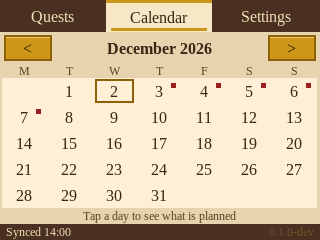
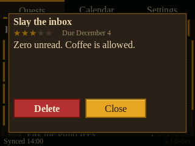
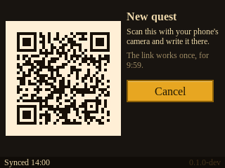

# cyd-todo

A quest log and a calendar for the ESP32 "Cheap Yellow Display" (320x240, resistive touch), with a small server at home. Tasks are **quests** (finish one, get XP, level up); the calendar holds **events** with a start, an end and a description. Built on [cydui](https://github.com/gventino/cydui), the immediate-mode UI library for that screen, as the real application that proves its API before 1.0.0.

Nothing is typed on the display:
- **Wi-Fi** is set up by scanning a QR code: the board opens its own access point, the phone joins it and fills a page (network, password, server, token). If the board is already connected when it restarts, no QR appears.
- **Quests and events** are written on the phone: a button on the display shows a QR code with a one-time link to a page of the server, and the board shows the new item seconds after you save.

> **Status: development only.** The board talks to the server over **plain HTTP**. Do not put real data in it and do not expose the server outside your LAN until the TLS step (A7 in the plan) is done. See [`docs/threat.md`](docs/threat.md).

## Screens
The real 320 x 240 screens, rendered by the PC program with the demo data (`firmware/tools/shots.sh`). Day palette, then night (candlelight).

| Quests | Calendar | Agenda of a day | Settings |
|---|---|---|---|
|  |  |  |  |

| Quest details | New quest (QR) | Wi-Fi setup (QR) | Quests, night |
|---|---|---|---|
|  |  |  |  |

## Layout
| Path | What |
|---|---|
| `server/` | Rust: `poem`, `sqlx`, SQLite. The device API and the phone pages. |
| `firmware/` | ESP-IDF 5.5 application, and a PC build (SDL) for development and tests. `third_party/cydui` is the library, pinned to a release tag. |
| `docs/api.md` | The contract between the board, the phone and the server, with its limits. |
| `docs/design.md` | Screens, data, setup flow, sync, memory. |
| `docs/threat.md` | A short threat model and the state of each control. |
| `docs/findings.md` | What the library got wrong or made hard (feeds `cydui` 1.0.0). |

## Getting the code
```sh
git clone --recurse-submodules https://github.com/gventino/cyd-todo.git
# or, in an existing clone:  git submodule update --init
```

## Status of the plan
A0 repository and contract (done) - A1 server device API (done, see `server/README.md`) - A2 server phone pages (done) - A3 model and UI on the PC (done: model, repository, theme, QR, every screen, scripted runs and about 90 golden pictures) - A4 Wi-Fi setup by QR (done and accepted on the board with a phone: the same UI as the PC, 37 of 37 scene hashes, access point, captive portal, no QR once connected) - A5 network and sync (the board syncs with the server: SNTP time, lists, polling, every injected fault survived; accepted with a phone, judged by the server's database) - A6 polish and hardening (A6.0 done; persisted settings, backlight, animations, fuzz and soak next) - A7 TLS.

## License
MIT, see `LICENSE`. Third party: the QR encoder of Project Nayuki (MIT, `firmware/components/qr/vendor/`) and Liberation Serif (SIL OFL). The serif font that will be bundled is under the SIL OFL (its license is in `firmware/components/theme_quest/fonts/`).

## Firmware, PC build
Fonts are generated, and checked by `ci.sh`, with a venv: `python3 -m venv firmware/tools/.venv && firmware/tools/.venv/bin/pip install -r firmware/third_party/cydui/tools/requirements.txt`, then `firmware/tools/gen_fonts.sh [--check]`.

The PC program renders any screen without a window (`firmware/pc/build/todo_pc --list`, `--scene agenda --palette night --png out.png`); built with `-DTODO_SDL=ON` it opens a window where the mouse is the touch screen.
