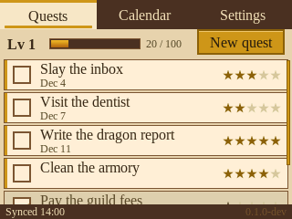
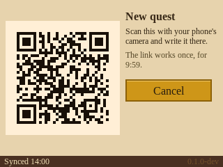

# cyd-todo

**A to-do list that plays like an RPG, on a cheap gadget for your desk: the ESP32 "Cheap Yellow Display" (CYD).** Your tasks are *quests*: finish one, earn XP, level up. A calendar holds your events. A small server at home keeps everything in one SQLite file, and **nothing is ever typed on the tiny screen**: you write on your phone.

[](LICENSE)   

| Quests | Calendar | Agenda of a day | New quest (QR) |
|---|---|---|---|
|  |  |  |  |

## See it running

Filmed on the real board: [the quests and the calendar](docs/media/board-quests-and-calendar.mp4) (30 seconds of taps on the checkboxes, the calendar and an agenda) and [writing a quest on the phone](docs/media/phone-qr-to-board.mp4) (the QR code on the board, the phone page, and the new quest showing up on the screen).

## How it works

```
   phone ──(scan the QR on the board, write a quest)──▶ server ◀──(Wi-Fi, polls for changes)── board (CYD)
                                                          │
                                                       SQLite
```

- **Tap the checkbox on the board** and the quest is done: XP goes up, the card eases to its done look, a level-up pulses gold.
- **Tap "New quest" and a QR code appears.** Scan it with your phone camera: a plain page (no app, no JavaScript) opens, you type the quest, and the board shows it seconds later. The link works once and expires.
- **No keyboard, no Wi-Fi typing on the board.** The first start shows a QR code for the board's own network: join it from your phone, pick your Wi-Fi and give it the server's address, and that is it. When it is already connected, no QR at all.
- **Yours, at home.** The server is a small Rust program (`poem` + `sqlx` + SQLite) for your own network. The screen dims after a while and wakes on a touch; the theme, time zone and backlight timeout survive a reboot.

> **Status: development only.** The board talks to the server over **plain HTTP** on your LAN. Do not put real data in it and do not expose the server to the internet until the TLS step (A7 in the plan) is done. See [`docs/threat.md`](docs/threat.md) for what is protected today and what is not.

## Try it (a CYD and a computer on the same Wi-Fi)

```sh
git clone --recurse-submodules https://github.com/gventino/cyd-todo.git && cd cyd-todo
scripts/dev.sh doctor      # what is missing here (Rust, ESP-IDF 5.5, the library submodule)
scripts/dev.sh setup       # a fresh token and your LAN address in .env; prints what to type on the phone
scripts/dev.sh server      # terminal 1: build and run the server
scripts/dev.sh board       # terminal 2: build, flash and watch the board (PORT=/dev/ttyUSB0 if needed)
```

Then, on the board: scan the Wi-Fi QR with your phone, join the board's network, fill the page with your Wi-Fi, the **Server** and the **Token** that `setup` printed. If the board cannot reach the server, `scripts/dev.sh firewall` prints the rule you probably need. `scripts/dev.sh link quest` gives a phone link without the board, to try the pages alone.

No board? The same screens run on your PC: see "Firmware, PC build" below.

## What is in the repository

| Path | What |
|---|---|
| `server/` | Rust: `poem`, `sqlx`, SQLite. The device API and the phone pages (`server/README.md`). |
| `firmware/` | ESP-IDF 5.5 application in C99, and a PC build (SDL) for development and tests. `third_party/cydui` is the UI library, pinned to a release tag (v1.0.0). |
| `scripts/dev.sh` | One entry point to try it: doctor, setup, server, board, phone links, firewall hint. |
| `docs/api.md` | The contract between the board, the phone and the server, with its limits. |
| `docs/design.md` | Screens, data, setup flow, sync, memory, measurements. |
| `docs/threat.md` | A short threat model and the state of each control. |
| `docs/findings.md` | What the library got wrong or made hard (it fed [cydui](https://github.com/gventino/cydui) 1.0.0). |

## Why this exists
It is the real application that had to prove the API of [cydui](https://github.com/gventino/cydui), an immediate-mode UI library for the CYD, before that library's 1.0.0: a to-do list with a server, a phone and a Wi-Fi setup that exercises lists, popups, themes, animations, QR codes and a network under bad conditions (every fault the server can inject was survived on the board). If you are looking for an example of a **complete CYD project**, not a demo, this is meant to be it.

## Built with
Firmware: C99, ESP-IDF 5.5, [cydui](https://github.com/gventino/cydui), Nayuki's QR encoder (MIT). Server: Rust, poem, sqlx, SQLite. Tests: Unity with sanitizers, golden pictures (about 90, hash-checked on the board too), a server fault-injection mode, an acceptance script that judges by the server's database (`firmware/tools/accept_db.py`).

## Status of the plan
A0 repository and contract, A1 server device API, A2 phone pages, A3 model and UI on the PC, A4 Wi-Fi setup by QR (accepted on the board with a phone), A5 network and sync (accepted with a phone, judged by the server's database), A6 polish (settings kept in flash, backlight dimming, animations; the whole-app fuzz and a long soak were skipped on purpose, see `docs/design.md`) are **done**. A7 TLS is next; `v0.1.0` comes after it.

## License
MIT, see `LICENSE`. Third party: the QR encoder of Project Nayuki (MIT, `firmware/components/qr/vendor/`) and Liberation Serif (SIL OFL). The serif font that will be bundled is under the SIL OFL (its license is in `firmware/components/theme_quest/fonts/`).

## Firmware, PC build
Fonts are generated, and checked by `ci.sh`, with a venv: `python3 -m venv firmware/tools/.venv && firmware/tools/.venv/bin/pip install -r firmware/third_party/cydui/tools/requirements.txt`, then `firmware/tools/gen_fonts.sh [--check]`.

The PC program renders any screen without a window (`firmware/pc/build/todo_pc --list`, `--scene agenda --palette night --png out.png`); built with `-DTODO_SDL=ON` it opens a window where the mouse is the touch screen.
