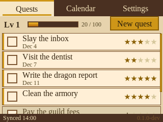
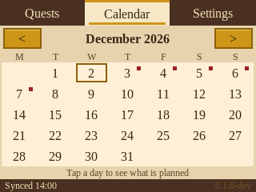
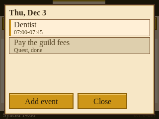
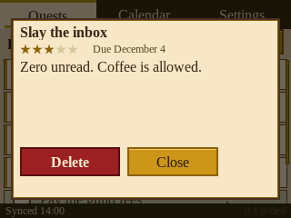
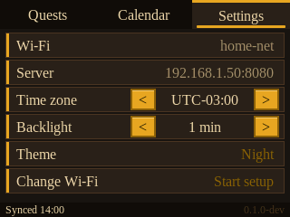
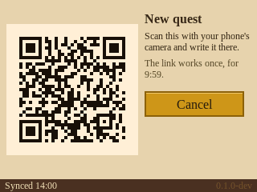
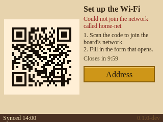

# Design

cyd-todo is a quest log and a calendar for the ESP32 "Cheap Yellow Display" (320x240, resistive touch, no PSRAM), with a small server at home. It is also the real application that `cydui` needs before 1.0.0: everything the library gets in the way of is written in `findings.md`.

Nothing is typed on the display. Wi-Fi is set up from a phone by scanning a QR code, and quests and events are entered on the phone through a page of the server, again behind a QR code. The display is for looking and for taps that need no keyboard.

## What it holds
- **Quest**: title (1..64 bytes), notes (0..256), difficulty 1..5, optional due date, state open/done. Done gives **XP**: `difficulty * 10`.
- **Event**: title (1..64), start and end (UTC epoch seconds, end after start, at most 31 days long), description (0..256).
- Limits are the ones in `api.md`; the firmware's fixed arrays have the same sizes.

## Levels (integer math)
Total XP needed to *reach* level `L` (L >= 1) is `50 * L * (L - 1)`: level 1 at 0 XP, 2 at 100, 3 at 300, 4 at 600, 5 at 1000. From `xp` the device finds `L` by a loop (no square root) and shows `xp - need(L)` over `need(L+1) - need(L)` as a bar. A quest of difficulty 5 is 50 XP, so level 2 is two of them.

## Screens (320 x 240)
Three tabs at the top (parchment on dark wood): **Quests**, **Calendar**, **Settings**. A thin status line at the bottom: `Synced 12:04`, `Offline`, `Waiting for time`, or an error.

 
 
  

*(Rendered by `firmware/tools/shots.sh`; the sketches of the first plan became these screens. Every one of them has a golden hash in `firmware/pc/golden/`.)*
- A **quest card** is a row at least 32 px tall (touch target): a checkbox (tap to complete, with a short animation and the XP gained), the title, stars for the difficulty, the due date. Tapping the title opens a popup with the notes and a *Delete* button; delete asks again (a confirmation popup, CT-22). Done quests are faded and sit below the open ones.
- **New quest** (header of the Quests tab) and **Add event** (in the agenda) open the **QR page**: not a popup but a page of its own, because the code is 164 px of the 240. The code on the left; on the right the title, a line of instruction, the time the link has left and **Cancel**. The board asks `POST /link` first (`Preparing...`; on failure the page says why and offers **Retry**), asks `GET /changes` every 3 seconds while it is open, and closes by itself with a toast `Saved on your phone` when the revision moves (and for good after 10 minutes, with `Link expired`).
- **Calendar**: month grid (Monday first, as many rows as the month needs: 4 to 6), days with events marked by a small square, today ringed, the selected day filled; a line under it says what the selected day holds. **Tapping a day opens its agenda as a popup** (the 192 px under the tabs cannot hold a grid and a list): the events of the day in order (`10:00-10:45`; `22:00 until Thu 01:30`, `Until 01:30`, `All day`) and the quests due that day, **Add event** and **Close**. Tapping an item opens its **detail** (full title, notes or the start and end, **Delete** in wax, then a modal **confirmation**: two taps, and the server answers last). `<` and `>` change month and ask for that month's events (the month and a week on either side).
- **Settings**: rows for the Wi-Fi network and the server address (shown), **Time zone** and **Backlight** (arrows through a list), **Theme** (Day / Night, switched live) and **Change Wi-Fi** (asks first, then the setup page). The version is in the status line.

## Wi-Fi setup by QR
The board decides at boot:

```
boot
 |
 +-- credentials in NVS? --no--> SETUP
 |         |yes
 |         v
 |   connect (up to 3 tries, 15 s each) --ok--> NORMAL (no QR at all)
 |         |fail
 |         v
 |   SETUP, with the message "Could not join <ssid>"
 |
 SETUP: open an access point "cyd-todo-XXXX" (WPA2, a random 8-character password), show the Wi-Fi QR
        WIFI:T:WPA;S:cyd-todo-XXXX;P:<password>;;   and the text of the steps.
        Phone joins -> the captive portal opens the form (or the address 192.168.4.1 by hand, shown on
        screen as text and as a second QR).
        Form: network (a list the board scanned), password, server address, device token -> POST.
        The board validates, stores in NVS, stops the access point, tries to join:
          ok    -> NORMAL, the QR is gone; the form tells the phone it worked.
          fail  -> back to SETUP with the reason on screen and in the form.
        The window closes after 10 minutes (the QR is replaced by "Setup timed out. Tap to try again").
```
Access point and station are never on together except for the instant of the trial. Setup can also be started from Settings, which erases nothing until the form is submitted successfully.

## QR codes (A3.4)
`firmware/components/qr` wraps Nayuki's C encoder (v1.8.0, MIT, vendored unmodified, checked by `ci.sh`). Error correction medium (raised when there is room), versions 1 to 5 (84 bytes at most); the contract URL of 61 bytes is version 4, 33 modules. A code is drawn as **one paper rectangle plus one A4 bitmap**: 4 px modules, a 4-module quiet zone, 164 px square for version 4 (13.4 KB of mask in a 16.2 KB buffer that the UI owns and reuses). Always dark on light, in both palettes. A new code in the same buffer is announced with `cydui_invalidate()` (findings 1 and 6). Every golden picture is **decoded by `zbarimg`** (`pc/tests/decode_qr.sh`) and compared with the text that was encoded; the test skips with a warning if no decoder is installed. Whether a phone reads it off the real LCD is judged at A4.

## Where things run
- **UI task** owns the model and everything `cydui` (the library is not thread-safe, CT-11). It draws at most when something changed and sleeps otherwise (the library's dirty regions, `cydui_ui_end` returning false).
- **Network task** owns Wi-Fi, SNTP and HTTP. It takes *requests* from a queue (`refresh quests`, `refresh events for [from, to)`, `complete quest id`, `delete id`, `new link kind`, `poll changes`) and posts *results* to another queue. It never touches the model or the UI. One request at a time, a 15 s timeout, a 16 KB response buffer that is never exceeded (the HTTP client is told the maximum and gives up the connection when the server says more).
- **Provisioning** (setup mode) has its own tiny HTTP server and a DNS answerer while it lasts, and none of the above runs then.

## Sync
Server is the truth. The board keeps a small cache in RAM: every open quest (up to 48) and the events of the month on screen plus a week on either side (up to 48). It refreshes:
- when a tab or month is opened, after a tap that changed something, and when `GET /changes` says the revision moved;
- every 60 s while idle (a single ~30-byte call), every 3 s while a QR is on the screen.
A tap (complete, delete) is applied on the screen at once and sent; if the request fails the card goes back and the status line says so. No offline queue in v1: offline, the board shows what it has and says `Offline`. Conflicts are last-write-wins on the server.

## Time
Nothing with a date is drawn before SNTP has answered (`Waiting for time`). A fixed UTC offset from Settings (no DST table on the device) turns epoch seconds into dates; events are stored in UTC, so changing the offset only changes how they are shown. Date math (civil-from-days, weekday, month grids, leap years) is integer-only and tested on the PC.

## Memory (measured at A4 and A5, not assumed)
Free heap in the library's gallery before Wi-Fi: about 293 KB. Wi-Fi station and lwIP take 60 to 80 KB, the HTTP buffer 16 KB, the model under 12 KB, the QR mask about 14 KB while shown, the UI storage about 20 KB (320 commands, 1.5 KB of text, at least 64 state entries). Goal: at least 100 KB free during a sync and 80 KB during setup. If it does not fit: smaller caches first, then smaller strips.

## Budget of the screens (measured at A3.5)
`pc/tests/test_budget.c` renders every named scene (`todo_pc --list`: quests, calendar, a six-row month, agenda, details, confirmations, settings, both QR pages, setup, toast) in both palettes, with the demo data and with the worst case the limits allow (60 quests and events with 64-byte titles and 256-byte notes, a crowded day, a dot on every day), in the memory the board will have: **320 commands, 1536 bytes of text, 64 state entries, 20-row strips**. The busiest frame is **112 of 320 commands** (the agenda); the worst-case scenes need between 512 and 768 bytes of text memory. No library error is raised in any of them. The look of every scene and of 13 scripted runs is pinned by golden hashes (`firmware/pc/golden/`), identical under gcc and clang, which the board must reproduce in A4.

## Look
The `quest` theme lives in this repository (`firmware/components/theme_quest`, not in the library): a parchment page, dark wood tabs, a gold accent, red wax for destructive buttons, borders as stacked rectangles (3 to 6 commands per widget), a serif font (Liberation Serif, OFL, Latin-1: regular 12 and 16, bold 16 and 24) made by `firmware/tools/gen_fonts.sh` with the library's `fontgen.py` and checked by `ci.sh`, the XP bar as a gradient, stars from a 12x12 A4 mask, a short fade-in of cards (`cydui_animate`, from A3.5). A second palette, "candlelight", for the dark. A test checks that every screen fits the 320-command list.

Decided from the rendered sheets (A3.3, `pc/golden/quest_{widgets,type,parts}_*`): the **16 px serif is the body** (titles, buttons, tabs); the **12 px serif is for secondary information only** (due dates, status line, agenda times, captions), where it is legible on the PC at 1:1 but small; whether it stays comfortable on the real LCD is judged at A4, and the fallback is the library's sans 12 for those lines. Contrast is checked by test (text 7:1, muted and the text on gold, wood and wax at least 4.5:1, in both palettes).

## Repository layout
```
server/             Rust: poem, sqlx, SQLite (the device API and the phone pages)
firmware/
  third_party/cydui the library, a git submodule pinned to a tag (CYDUI_ROOT overrides it for development)
  components/       model, repo, net, jsonr, provision, qr, ui, theme_quest (pure C where possible)
  main/             the ESP-IDF application
  pc/               SDL + in-memory repository: the main development loop, goldens, tests, fuzz
docs/               api.md, design.md, threat.md, findings.md
```
